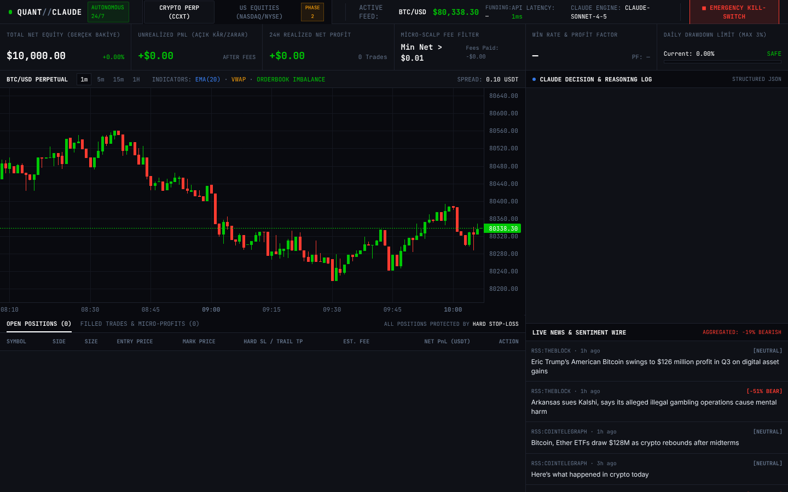

# AI Crypto Trading Bot (Claude Quant Terminal)

Kripto vadeli ve spot piyasada çalışan hibrit bir trading sistemi. Teknik sinyalleri Python hesaplıyor, Claude bu sinyalleri haberlerle birlikte değerlendirip onay veriyor ya da reddediyor. Claude'un kararından bağımsız çalışan bir risk katmanı her işlemi denetliyor ve Claude bu katmanı aşamıyor.



> **Uyarı:** Bu proje eğitim ve portfolyo amaçlıdır, yatırım tavsiyesi değildir. Gerçek parayla kullanmak tamamen kendi sorumluluğundadır. Önce `PAPER`, sonra `TESTNET` modunda dene.

**English summary.** A hybrid crypto trading system. Deterministic Python computes indicators and strategy signals; Claude (Anthropic API, forced tool use) acts as a meta-agent that confirms, rejects or reduces each signal using market data and deduplicated news; an independent hard-risk engine (fee gate, position sizing, 5x leverage cap, isolated margin, daily-drawdown kill switch) has the final word. Orders go through CCXT with exchange-resting hard stops, break-even/trailing management and periodic exchange reconciliation. FastAPI + WebSocket feed a real-time web terminal. Modes: `PAPER` (live data, simulated fills), `TESTNET`, `LIVE` (multi-lock). Docker Compose with TimescaleDB, a pre-flight safety CLI and 715 tests. Setup guide (Turkish): `RUNBOOK_TR.md`.

## Durum: 5 adımın hepsi tamamlandı

| Adım | İçerik | Durum |
|---|---|---|
| 1 | Klasör yapısı, broker soyutlaması, veritabanı şeması, katı risk motoru | Bitti |
| 2 | Asenkron veri ve haber motoru, indikatörler, strateji ön-filtresi | Bitti |
| 3 | Claude karar çekirdeği, emir icrası, pozisyon yöneticisi | Bitti |
| 4 | FastAPI, WebSocket `/ws/terminal`, web terminali | Bitti |
| 5 | Docker, borsa mutabakatı, PAPER/TESTNET/LIVE modları, preflight aracı | Bitti, toplam 715 test geçiyor |

Kurulum ve kullanım için `RUNBOOK_TR.md` dosyasına bak.

## Klasörler

```
app/
  core/       types.py (Decimal tabanlı ortak tipler), errors.py
  config/     settings.py (.env okuma, risk limitleri, LIVE kilidi)
  brokers/    base.py (BaseBrokerAdapter), ccxt_adapter.py, paper_adapter.py,
              alpaca_adapter.py (Faz 2 şablonu, PDT ve seans saati hazır), factory.py
  db/         models.py, session.py, repository.py
  risk/       fee_calculator.py, position_sizer.py, kill_switch.py,
              risk_engine.py, watchdog.py, db_adapters.py
  data/       WebSocket veri motoru: buffers.py (sabit boyutlu tamponlar), health.py
              (bayat veri ve PAUSE kapısı), backoff.py, sources.py (ccxt.pro), engine.py,
              mock_source.py (testler için sahte canlı akış)
  news/       haber motoru: RSS, CryptoPanic, X, SEC/Fed; tekilleştirme, ilgililik
              filtresi, basit duygu skoru, sınırlı önbellek ve veritabanı kaydı
  quant/      artımlı indikatörler (RSI, EMA 20/50, VWAP, Bollinger, ATR, emir defteri
              dengesizliği), 3 strateji, komisyon duyarlı ön-filtre, SignalPayload
  claude/     karar çekirdeği: prompt.py (system prompt, güvenilmeyen haber etiketi),
              tool.py (zorunlu tool_use şeması), core.py (timeout, circuit breaker, HOLD'a
              düşme), decision_log.py (Türkçe gerekçenin veritabanı kaydı)
  execution/  executor.py (emir döngüsü), drift_guard.py (fiyat kayması), position_manager.py
              (break-even ve iz süren stop), recorder.py (emir ve işlem kaydı)
  pipeline.py veri, haber ve quant motorlarını EventBus üzerinden bağlar
  decision_service.py  tetikleme -> Claude -> risk -> icra zinciri
  runtime.py  bütün bileşenleri ayarlardan kurar, sırayla başlatır ve tersine durdurur
  api/        main.py (FastAPI + lifespan), routes.py (REST), ws_hub.py (/ws/terminal),
              backend.py (terminal verileri), protocol.py (mesaj şeması), server.py (çalıştırıcı)
  cli/        preflight.py (python -m app.cli.preflight: uçuş öncesi güvenlik kontrolü)
  execution/reconciliation.py  açılışta ve 60 sn'de bir borsa ile yerel durumu eşitler
  execution/live_guard.py      LIVE açılış kilidi (bakiye, izole marjin, kaldıraç)
static/       index.html (web terminali, senin tasarımın; index.original.html ilk hali)
  core/events.py  sınırlı kuyruklu iç olay veri yolu
migrations/   001_initial_schema.sql (PostgreSQL + TimescaleDB)
tests/        birim ve entegrasyon testleri (ağ bağlantısı gerekmez)
```

## Risk motoru ne yapıyor

- **Komisyon kapısı:** Beklenen brüt kâr, gidiş-dönüş maliyetinin (komisyon, slippage ve funding toplamı) en az 2 katı değilse işlem açılmaz.
- **Kill-switch:** Günlük zarar %3'e ulaşınca bütün emirleri iptal eder, pozisyonları kapatır ve gerçekten kapandığını kontrol eder. Marjin oranı aşıldığında ya da arka arkaya kayıp geldiğinde de devreye girer. Durumu veritabanına yazar, bu yüzden program yeniden başlasa da kapalı kalır. Tekrar açmak için `manual_reset(operator, "RESET")` çağrılmalı.
- **Zorunlu koruma emirleri:** Her pozisyon için borsaya STOP_MARKET, TAKE_PROFIT ve +1R'de devreye giren trailing stop gönderilir.
- **Kaldıraç ve marjin:** Kaldıraç en fazla 5x olabilir, fazlası 5x'e düşürülür. Sadece izole marjine izin verilir. Likidasyon fiyatı stop fiyatından önce geliyorsa kaldıraç düşürülür.
- **Pozisyon büyüklüğü:** Stop çalışırsa kaybedilecek tutar bakiyenin en fazla %0,5'i olacak şekilde hesaplanır. Komisyon ve slippage bu hesaba dahildir.
- **Watchdog:** Her saniye hesabı denetler. Stop emri olmayan bir pozisyon bulursa önce stop koymayı dener, olmazsa pozisyonu kapatır.

## Adım 2 kuralları

- **Bayat veri:** Emir defteri ya da fiyat 2 saniyeden uzun süre güncellenmezse veya bağlantı koparsa o sembol PAUSE moduna geçer ve sinyal üretilmez. Yeniden bağlanma üstel bekleme süresiyle yapılır. Veri en az 1 saniye kesintisiz akmadan kapı açılmaz. Pipeline, sağlık kontrolünü beklemeden emir defterinin yaşına ayrıca bakar.
- **Bellek:** Mumlar `deque(maxlen=1000)` içinde tutulur. Emir defterinden yalnızca ilk 20 seviye saklanır. Haber önbelleği, tekrar kontrolü ve olay kuyruklarının hepsi sınırlı. Kuyruk dolarsa en eski olay atılır.
- **Ön-filtre:** Claude her mumda çağrılmaz. Strateji uyumu 0,7 ya da üstünde olmalı. ATR'ye göre hesaplanan hedef, gidiş-dönüş maliyetinin en az 2 katını kazandırmalı. Aynı sembol ve yön için 5 dakika beklenir, saatte en fazla 12 tetikleme yapılır.
- **Haber:** Aynı haber hangi kaynaktan gelirse gelsin bir kez yayınlanır. Bunun için URL normalleştirilip hash'lenir ve başlıklar benzerliğe göre karşılaştırılır. Haberi taşıyan diğer kaynaklar kaydedilir. İzlenen coinlerle ya da makro konularla (FED, CPI, SEC, ETF, HACK, düzenleme, borsa) ilgisi olmayan haberler atılır.

## Adım 3 kuralları

- **Zorunlu şema:** Claude sadece `submit_trading_decision` aracıyla cevap verebilir. 6 saniyelik zaman aşımı, hız sınırı, API hatası, bozuk ya da şemaya uymayan cevap, ters yöne çevrilmiş işlem veya mantıksız stop seviyesi durumlarında sistem çökmez, kararı HOLD'a çevirir ve nedenini kaydeder. Arka arkaya 5 hata olursa Claude çağrıları 5 dakika durdurulur.
- **Haber güvenliği:** Haberler `<untrusted_market_news>` etiketi içinde gönderilir. `<` ve `>` karakterleri etkisiz hale getirilir, böylece bir haber etiketi kapatıp talimat ekleyemez. System prompt bu bölümün yalnızca piyasa verisi olduğunu söyler.
- **Fiyat kayması:** Emir gönderilmeden hemen önce güncel emir defterine bakılır. Fiyat sinyal anına göre aleyhte 0,3 ATR'den fazla kaçmışsa ya da emir defteri 2 saniyeden eskiyse işlem iptal edilir.
- **Emir sırası:** Önce risk motoru onay verir. Reddedilen işlem borsaya hiç gitmez, onaylanan işlemde de sadece risk motorunun kırptığı kaldıraç ve miktar kullanılır. Sonra giriş emri gönderilir. Emir dolar dolmaz `reduceOnly` stop ve ardından take-profit gönderilir. Stop 3 denemede yerleşmezse pozisyon piyasa emriyle hemen kapatılır ve kritik uyarı üretilir. Kapatma da başarısız olursa kill-switch devreye girer.
- **Kârı kilitleme:** Komisyon sonrası net kâr, gidiş-dönüş maliyetinin 2 katına ulaşınca stop "maliyet + komisyon + küçük pay" seviyesine çekilir. Sonra fiyat lehte gittikçe stop 1 ATR geriden takip eder ve hiç geri gevşemez. Stop taşınırken önce yeni stop konur, eski stop ancak ondan sonra iptal edilir. Böylece pozisyon bir an bile stopsuz kalmaz.

## Web terminali

```bash
python -m app.api.server
```

Sonra tarayıcıda `http://127.0.0.1:8000` adresini aç.

- Bağlanınca ilk mesaj `INITIAL_SNAPSHOT` olur. İçinde KPI'lar, son 120 mum ve işlem işaretleri, açık pozisyonlar, son 50 işlem, son 25 Claude kararı ve son 25 haber vardır.
- Canlı olaylar (Claude kararı, pozisyon açılış/güncelleme/kapanış, kill-switch, haber, veri sağlığı) anında gelir. Fiyat, mum, PnL ve KPI güncellemeleri en fazla 200 ms'de bir, birleştirilerek gönderilir.
- REST uç noktaları:
  - `POST /api/v1/kill-switch` anahtar istemez.
  - `POST /api/v1/kill-switch/resume` ve `POST /api/v1/positions/{sembol}/close` için `X-Control-Token` başlığı gerekir. Resume isteğinde ayrıca `RESET` onayı yazılmalıdır.
  - `GET /api/v1/health` bütün alt sistemlerin durumunu döner.
- Haber başlıkları ve Claude gerekçeleri ekrana basılmadan önce HTML kaçışından geçirilir. Bir haber başlığı sayfaya kod sokamaz.

## Kurulum

```bash
python -m venv .venv && .venv\Scripts\activate      # Windows
pip install -e ".[dev]"
copy .env.example .env
python -m pytest -q
```

Varsayılan mod `TRADING_MODE=PAPER` (sanal para). LIVE moda geçmek için `LIVE_TRADING_CONFIRMATION` değerine `I_UNDERSTAND_REAL_MONEY_IS_AT_RISK` cümlesinin birebir yazılması ve API anahtarlarının girilmesi gerekir. Bu ikisi yoksa program açılmaz. Borsada oluşturduğun API anahtarında para çekme iznini kapalı tut.

## Henüz test edilmeyenler

- `001_initial_schema.sql` gerçek bir PostgreSQL/TimescaleDB üzerinde çalıştırılmadı. Testler SQLite ile yapıldı. Adım 5'teki docker-compose ile doğrulanacak.
- CCXT adaptörünün emir parametreleri (Binance ve Bybit) birim testlerle doğrulandı, ama testnet'te gerçek emirle denenmedi.
- CCXT Pro WebSocket akışı ve RSS/CryptoPanic/X kaynakları gerçek ağda denenmedi. Testlerde sahte akış ve sahte HTTP yanıtları kullanıldı.
- Claude API gerçek bir modelle çağrılmadı. Testlerde senaryolu sahte cevaplar kullanıldı. `.env` dosyasındaki `CLAUDE_MODEL` değerini kullanacağın modele göre ayarla.
- Fiyat stopun içinden boşlukla geçerse (gap) stop daha kötü bir fiyattan dolabilir. Break-even stop bu durumda zarara karşı garanti veremez.
- Haber duygu skoru basit bir kelime listesine dayanıyor. Haberin gerçek yorumu Adım 3'te Claude'a bırakılacak.
- Paper modu fiyatları CCXT'nin herkese açık verisinden alıyor. Gerçek emir defterindeki dolum ve kayma koşullarını tam olarak yansıtmaz.

